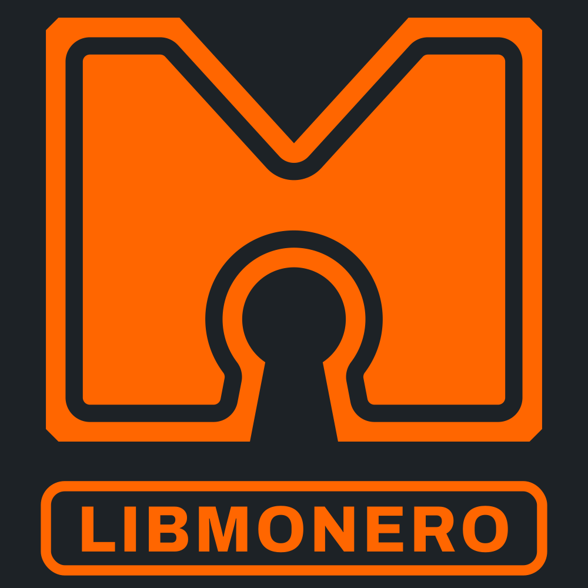
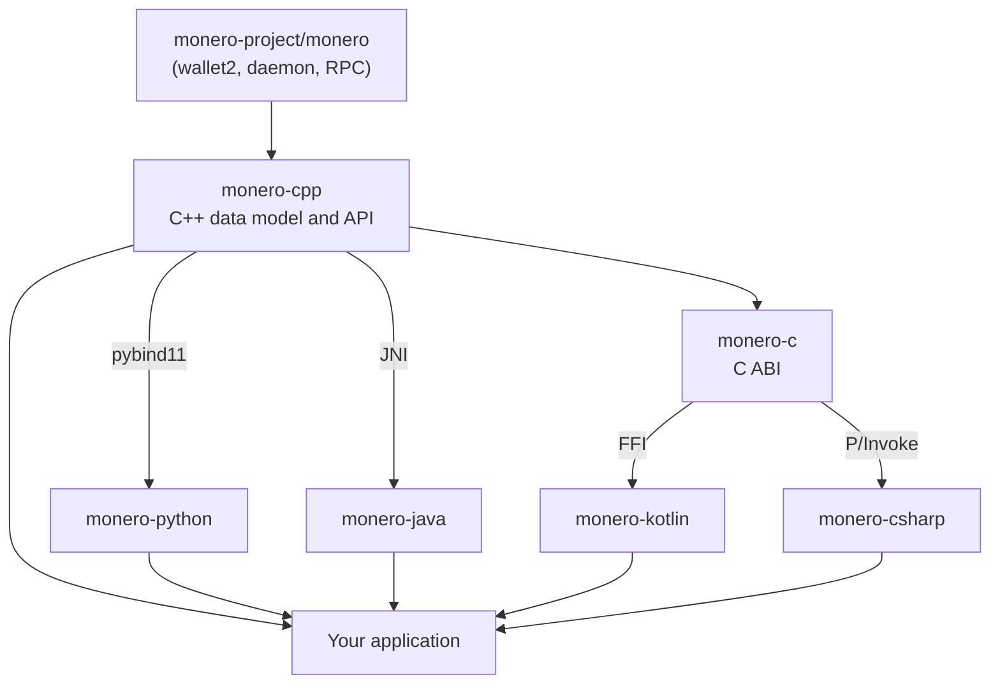

<p align="center">
  
</p>

<h1 align="center">Libmonero</h1>

<p align="center">
  <b>Libraries for building Monero applications, in the language you already use.</b>
</p>

---

libmonero maintains a family of Monero libraries that share one thing: the same **data model and API**. Learn it once, and the wallet, the daemon, the transactions and the listeners look the same in C++, C, Python, Java, Kotlin and C#.

Every library is built to the same ideas:

* **One clearly defined [data model and API specification](https://github.com/libmonero/monero-python/blob/main/docs/monero-spec.pdf)**, intended to be intuitive and robust, and implemented the same way in every language.
* **RPC clients and native bindings.** Talk to `monerod` and `monero-wallet-rpc`, or run a fully client-side wallet on top of [monero-project/monero](https://github.com/monero-project/monero) `wallet2`.
* **Interchangeable implementations.** A wallet backed by RPC and a wallet backed by native bindings conform to the same interface, so you can swap one for the other without rewriting your application.
* **Multisig, view-only, offline and keys-only wallets.**
* **Query and listen.** Find transactions, transfers and outputs by their properties, and receive notifications when blocks are added or when a wallet syncs, sends or receives.
* **Tested against real daemons and wallets**, with unit and integration tests in CI.

## Architecture



[monero-cpp](https://github.com/libmonero/monero-cpp) wraps Monero's `wallet2` and defines the data model. [monero-c](https://github.com/libmonero/monero-c) exposes it as a C ABI, so any language with an FFI can build on it. Python and Java bind to monero-cpp directly. Kotlin and C# bind to monero-c.

## Repositories

### Libraries

| Repository | Language | Bindings | Notes |
|------------|----------|----------|-------|
| [**monero-cpp**](https://github.com/libmonero/monero-cpp) | C++ | wraps `wallet2` | Core library and reference data model. Wallet and daemon RPC clients, full, keys-only, multisig, view-only and offline wallets. |
| [**monero-c**](https://github.com/libmonero/monero-c) | C | C ABI over monero-cpp | Opaque handles, JSON data and listener callbacks. Foundation for FFI bindings. |
| [**monero-python**](https://github.com/libmonero/monero-python) | Python 3.10 to 3.14 | pybind11 | Prebuilt `.deb` and wheel packages, [documentation](https://libmonero.github.io/monero-python/). |
| [**monero-java**](https://github.com/libmonero/monero-java) | Java | JNI | Over 300 tests. |
| [**monero-kotlin**](https://github.com/libmonero/monero-kotlin) | Kotlin | monero-c | Linux, macOS, Windows and Android (AAR). |
| [**monero-csharp**](https://github.com/libmonero/monero-csharp) | C# (.NET 10) | monero-c (P/Invoke) | Async API with cancellation. |

### Tooling

| Repository | Description |
|------------|-------------|
| [**docker-monero-rpc**](https://github.com/libmonero/docker-monero-rpc) | Docker images for `monerod` and `monero-wallet-rpc`, for development and testing against regtest or mainnet. |

> [!NOTE]
> Most of these projects are **under development and unfunded**. Expect bugs and breaking changes, and read the status notice at the top of each repository before depending on it. Wallets handle real funds: test on stagenet or testnet first.

## Quick look

Connect to a daemon and read the chain height, in every language:

```python
# Python
from monero import *

daemon = MoneroDaemonRpc("http://localhost:38081", "superuser", "abctesting123")
height = daemon.get_height()                    # 1523651

wallet = MoneroWalletRpc("http://localhost:38083", "rpc_user", "abc123")
wallet.open_wallet("sample_wallet_rpc", "supersecretpassword123")
balance = wallet.get_balance()                  # 533648366742 (atomic units)
```

```java
// Java
import monero.daemon.MoneroDaemon;
import monero.daemon.MoneroDaemonRpc;

MoneroDaemon daemon = new MoneroDaemonRpc("http://localhost:38081", "superuser", "abctesting123");
long height = daemon.getHeight();               // 1523651
```

```kotlin
// Kotlin
import monero.daemon.MoneroDaemonRpc

MoneroDaemonRpc("http://localhost:38081", "superuser", "abctesting123").use { daemon ->
    val height = daemon.getHeight()             // 1523651
}
```

```csharp
// C#
using Monero.Daemon;

MoneroDaemon daemon = new MoneroDaemonRpc("http://localhost:38081", "superuser", "abctesting123");
ulong height = await daemon.GetHeightAsync();   // 1523651
```

## Contributing

Contributions are welcome in every repository: bug reports, tests, documentation, new language bindings and fixes. Open an issue to discuss larger changes before sending a pull request.

Because the libraries share a model, an API change usually starts in the specification and then lands in each language. If you want to start somewhere, the integration tests and the documentation are a good first step.

## Acknowledgements

libmonero builds on the work of the [Monero Project](https://github.com/monero-project/monero) and on [woodser](https://github.com/woodser)'s [monero-cpp](https://github.com/woodser/monero-cpp), [monero-java](https://github.com/woodser/monero-java) and [monero-ts](https://github.com/woodser/monero-ts).

## License

The libraries are released under the [MIT License](https://opensource.org/licenses/MIT).
